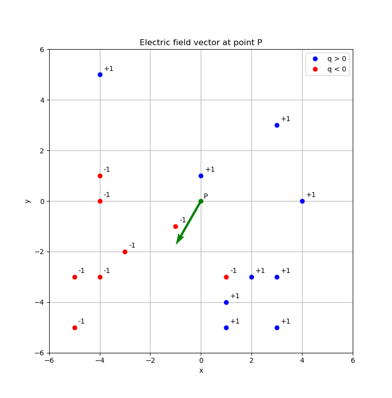
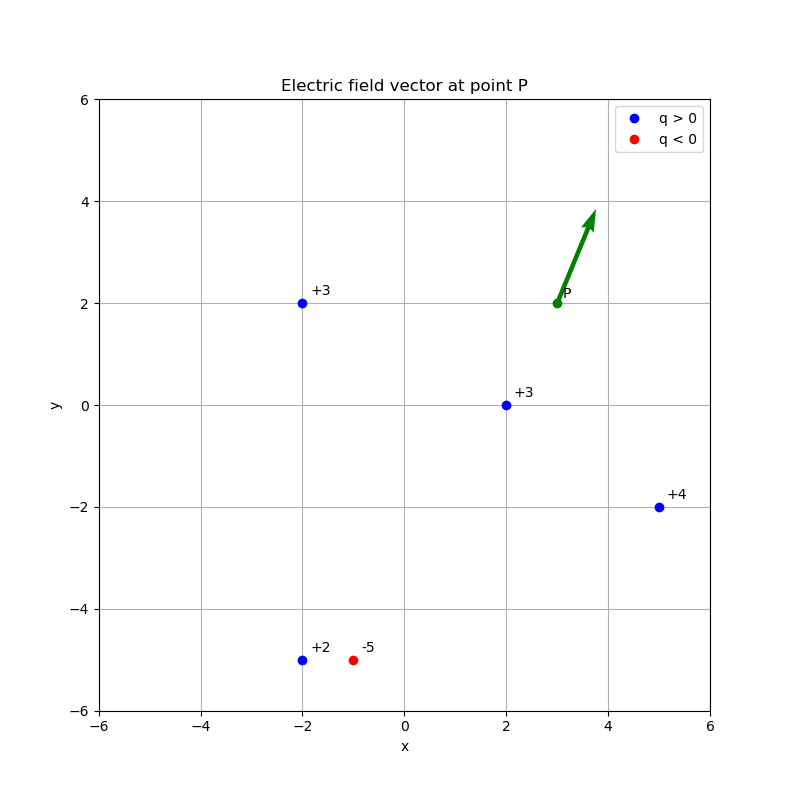
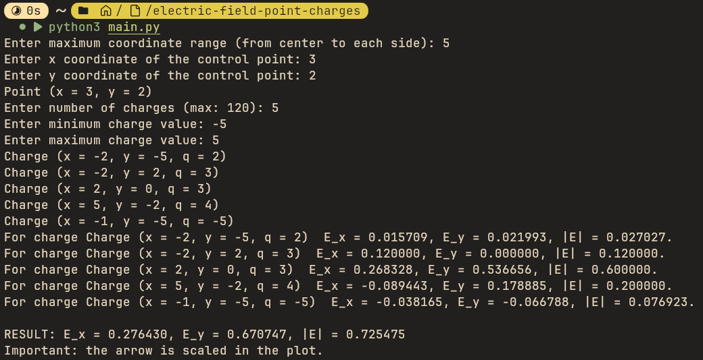
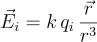
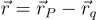
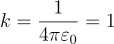
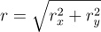

# Electric Field - Point Charges

This project simulates the **electric field vector** **E** at a chosen control point **P**, produced by multiple **point charges** randomly placed on a 2D grid.

The program:

- generates **unique** charge positions (no duplicates),
- prevents placing any charge at the control point coordinates,
- computes the electric field using the **superposition principle**,
- visualizes charges, the control point, and the **electric field vector** on a plot.

---

## Screenshots

### Example plot 1



### Example plot 2



### Console output example



---

## Project structure

- `charges.py` — **English version** (main script)
- `ladunki.py` — **Polish version** (original script kept for reference)
- `figures/` — screenshots and equation images used in this README

---

## Equations used in the project

### Electric field from a single point charge



### Position vector from the charge to the control point



### Constant used in the assignment

According to the assignment requirement:



In the code we use: **k = 1**

### Distance between charge and control point



---

## Features

- Random generation of **N unique** point charges on a 2D grid
- Charges never appear at the control point `(xP, yP)`
- Charge values are random integers in range `[q_min, q_max]` excluding `0`
- Visualization with Matplotlib:
  - `q > 0` → blue
  - `q < 0` → red
  - control point `P` → green
  - electric field vector at `P` → green arrow (**scaled for visibility**)

---

## Requirements

- Python 3
- NumPy
- Matplotlib

Install dependencies:

```bash
pip install numpy matplotlib
```
