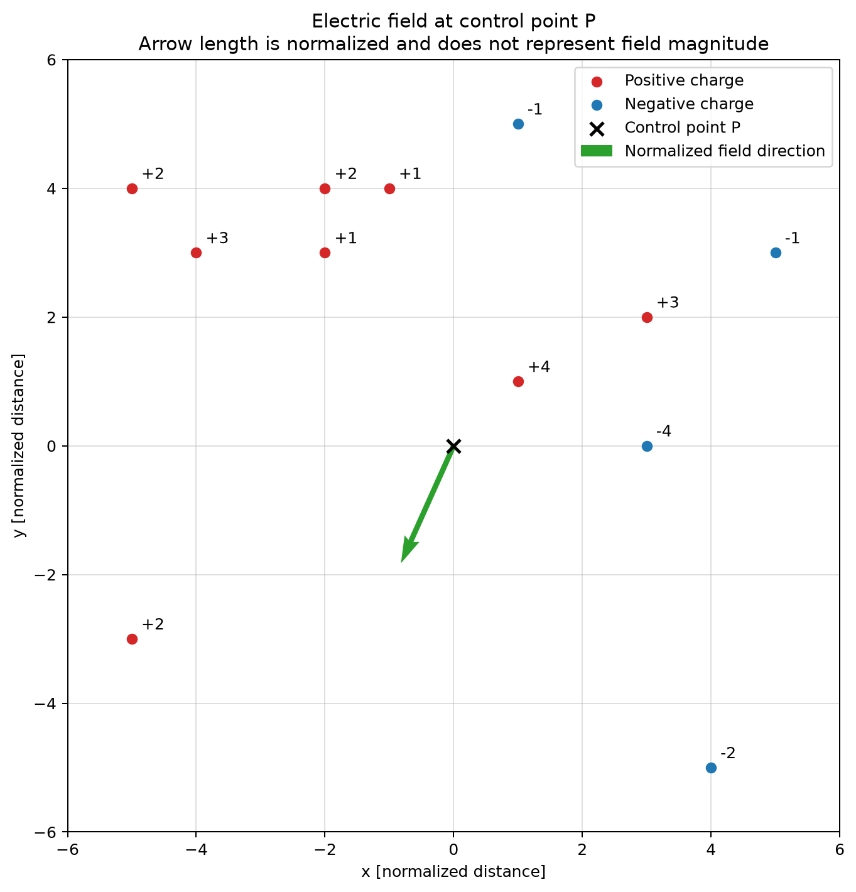

# Electric Field of Point Charges

[](https://github.com/ShOOmet14/electric-field-point-charges/actions/workflows/tests.yml)


A compact computational-physics program that calculates the resultant electric-field vector at one selected point due to multiple ideal point charges on a two-dimensional grid.

## Overview

The application generates point charges at unique random grid positions, evaluates each charge's contribution at a control point, and combines the contributions using superposition. It then plots the charge configuration and the direction of the resultant field.

The original university assignment defines a **normalized Coulomb constant** $k=1$. Charge values, distances, and calculated electric fields are therefore expressed in assignment-defined normalized units—not coulombs, metres, or volts per metre.

## Physical Model

For charge $q_i$ at position $\mathbf{r}_{q_i}$ and control point $\mathbf{r}_P$, the displacement vector points from the source charge to the control point:

```math
\mathbf{r}_i = \mathbf{r}_P - \mathbf{r}_{q_i}.
```

The field contribution is calculated from Coulomb's law:

```math
\mathbf{E}_i
=
kq_i\frac{\mathbf{r}_i}{\left\lVert\mathbf{r}_i\right\rVert^3},
\qquad k=1.
```

The resultant field follows from the superposition principle:

```math
\mathbf{E}_{\mathrm{total}} = \sum_{i=1}^{N}\mathbf{E}_i.
```

Positive charges produce a field directed away from the source; negative charges produce a field directed toward it. A field point that coincides with a source charge is undefined and raises a clear error instead of being replaced by an artificial small distance.

The model treats charges as stationary ideal point charges. Their geometry is represented in a two-dimensional plane, while the usual inverse-square point-charge law is evaluated from the planar displacement vector.

## Features

- Random nonzero integer charge values within a selected range
- Unique charge positions with the control point excluded
- Reproducible generation through an optional seeded NumPy generator
- Independent functions for single-charge fields and superposition
- Validation of coordinate, charge-value, count, and zero-distance cases
- Matplotlib visualization of charges and resultant-field direction
- Focused physics tests and continuous integration

## Visualisation



Positive charges are red, negative charges are blue, and the control point is marked with a black cross. The green arrow points in the calculated direction of $\mathbf{E}_{\mathrm{total}}$.

The arrow is always scaled to a fixed display length. Its plotted length **does not represent the calculated field magnitude**; the numerical components and magnitude are printed in the terminal.

## Installation

Python 3.12 is used in continuous integration.

```bash
git clone https://github.com/ShOOmet14/electric-field-point-charges.git
cd electric-field-point-charges
python -m venv venv
```

Activate the environment on Windows PowerShell:

```powershell
.\venv\Scripts\Activate.ps1
```

Or on macOS/Linux:

```bash
source venv/bin/activate
```

Install the runtime dependencies:

```bash
python -m pip install -r requirements.txt
```

## Usage

Run the interactive application from the repository root:

```bash
python charges.py
```

The program asks for:

1. the grid radius, which defines coordinates from `-radius` to `+radius`;
2. the control-point coordinates;
3. the number of charges;
4. the inclusive minimum and maximum integer charge values.

The charge-value range must contain at least one nonzero integer. Generated positions are unique and never coincide with the control point.

## Testing

Install the development dependencies and run pytest:

```bash
python -m pip install -r requirements-dev.txt
python -m pytest -q
```

The tests cover positive and negative charge direction, inverse-square scaling, vector superposition, symmetry and complete cancellation, undefined zero distance, the configurable normalized constant, deterministic random generation, unique positions, control-point exclusion, nonzero charges, and invalid input ranges.

## Project Structure

```text
├── .github/workflows/tests.yml  Continuous integration
├── figures/                     Example result plot
├── tests/test_charges.py        Physics and generation tests
├── charges.py                   Calculation, interaction, and visualization
├── requirements.txt             Runtime dependencies
└── requirements-dev.txt         Test dependencies
```

## Limitations

- The electric field is evaluated at one control point, not across a spatial grid.
- Charges are stationary ideal point charges represented in two dimensions.
- The assignment uses normalized $k=1$ and dimensionless input values, so results are not SI electric-field values.
- The displayed field-arrow length is normalized for readability.
- No electric-potential calculation, field map, field lines, dynamics, boundaries, or material response are included.

## Future Development

Realistic extensions could evaluate the field or electric potential on a two-dimensional grid, display a vector-field map, or accept manually specified charge configurations. These are intentionally outside the current assignment-scale implementation.
